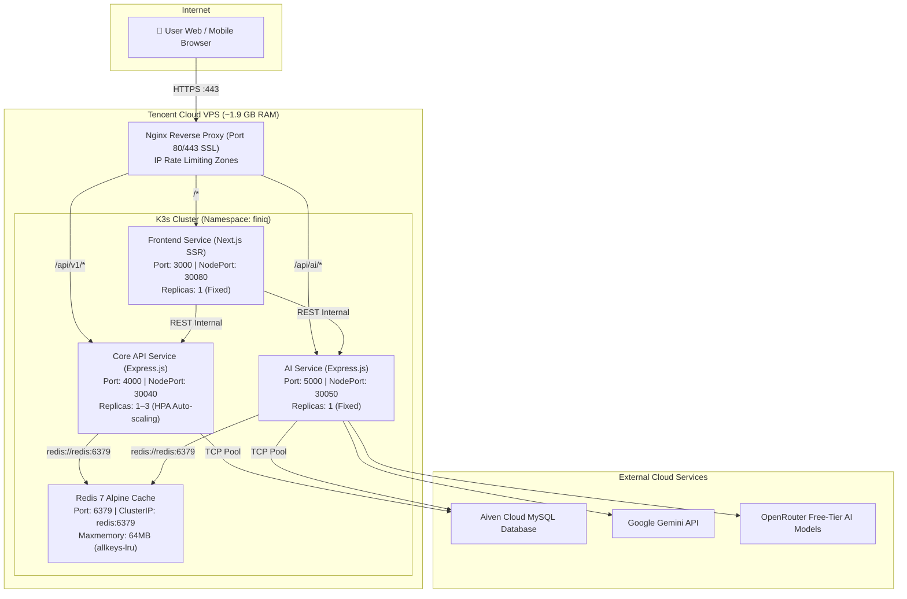

# 🏗️ Fin.IQ Microservices Architecture & Project Structure

Dokumen ini menjelaskan arsitektur sistem, struktur monorepo, pembagian layanan microservices, konfigurasi Kubernetes (K3s), mekanisme automasi Redis, serta daftar REST API endpoint pada **Fin.IQ**.

---

## 1. Diagram Arsitektur Sistem



---

## 2. Struktur Monorepo (Workspaces)

Proyek dikelola menggunakan **npm workspaces** dengan 3 packages utama dan 1 aplikasi frontend Next.js:

```
Fin.IQ/
├── package.json                   # Root workspace configuration & scripts
├── tsconfig.json                  # Root TypeScript configuration (Next.js scoped)
├── Dockerfile                     # Container builder untuk Frontend (Next.js)
├── packages/
│   ├── shared/                    # [PACKAGE] @finiq/shared
│   │   ├── package.json
│   │   ├── tsconfig.json
│   │   └── src/
│   │       ├── index.ts           # Barrel export semua modul shared
│   │       ├── db/
│   │       │   ├── index.ts       # Drizzle ORM instance & MySQL connection pool
│   │       │   └── schema.ts      # Schema tabel database (users, transactions, accounts, dll)
│   │       ├── auth/
│   │       │   └── index.ts       # JWT utilities + fallback legacy HMAC + scrypt password
│   │       ├── redis/
│   │       │   └── index.ts       # Redis client, session manager, revocation, IP rate limiter
│   │       └── types/
│   │           └── index.ts       # TypeScript shared interfaces & DTOs
│   │
│   ├── core-api/                  # [SERVICE] @finiq/core-api (Port 4000)
│   │   ├── package.json
│   │   ├── tsconfig.json
│   │   ├── Dockerfile             # Multi-stage Docker builder untuk Core API
│   │   └── src/
│   │       ├── index.ts           # Express server entry point & route mounting
│   │       ├── middleware/
│   │       │   ├── auth.ts        # Bearer JWT verification & Redis session check
│   │       │   ├── rate-limit.ts  # Redis sliding-window IP rate limiter
│   │       │   └── error.ts       # Zod validation & internal error handler
│   │       └── routes/
│   │           ├── auth.ts        # /auth/login, /auth/register, /auth/me, /auth/logout
│   │           ├── users.ts       # /users/profile, /users/change-password, /users/gemini-key
│   │           ├── transactions.ts# CRUD /transactions, batch-delete, summary agregasi
│   │           ├── accounts.ts    # CRUD /accounts & /accounts/:id/adjust-balance
│   │           ├── categories.ts  # CRUD /categories
│   │           ├── budgets.ts     # CRUD /budgets & kalkulasi pengeluaran aktual
│   │           ├── ledgers.ts     # CRUD /ledgers & sistem kolaborasi kode invite
│   │           ├── analytics.ts   # /analytics/hero-summary, trends, ranks, heatmap
│   │           └── import.ts      # /import/batch (import transaksi massal ke ledger)
│   │
│   └── ai-service/                # [SERVICE] @finiq/ai-service (Port 5000)
│       ├── package.json
│       ├── tsconfig.json
│       ├── Dockerfile             # Multi-stage Docker builder untuk AI Service
│       └── src/
│           ├── index.ts           # Express server entry point
│           ├── middleware/        # auth, rate-limit, errorHandler
│           ├── lib/
│           │   ├── gemini.ts      # Google Gemini client & auto-fallback runner
│           │   └── openrouter.ts  # OpenRouter client, guardrail, prompt quota limiter
│           └── routes/
│               ├── chat.ts        # /ai/chat, chat sessions & message history
│               ├── quota.ts       # /ai/quota (kuota harian 20 prompt & reset timer)
│               ├── models.ts      # /ai/models (daftar kurasi model free tier)
│               └── analyze.ts     # /ai/analyze/text (NLP) & /ai/analyze/vision (OCR Struk)
│
├── src/                           # [FRONTEND] Next.js 15 SSR & UI Application
│   ├── app/                       # App Router pages (/overview, /transactions, /ai, /login, dll)
│   ├── components/                # UI components (Shadcn/ui, Hallmark Design tokens)
│   ├── lib/
│   │   ├── api-client.ts          # REST client wrapper (coreApi & aiApi)
│   │   └── redis.ts               # Local Redis client fallback
│   └── server/
│       └── trpc/                  # tRPC routers (berfungsi sebagai proxy internal ke REST)
│
├── k8s/                           # Manifests Kubernetes (K3s)
│   ├── namespace.yaml             # Namespace 'finiq'
│   ├── redis/
│   │   └── deployment.yaml        # Redis 7 Alpine (64MB RAM limit, ClusterIP :6379)
│   ├── core-api/
│   │   ├── deployment.yaml        # Core API container (NodePort :30040)
│   │   └── hpa.yaml               # HorizontalPodAutoscaler (1-3 pods, CPU target 70%)
│   ├── ai-service/
│   │   └── deployment.yaml        # AI Service container (NodePort :30050)
│   ├── frontend/
│   │   └── deployment.yaml        # Next.js frontend container (NodePort :30080)
│   └── nginx.conf                 # Nginx Reverse Proxy config untuk host VPS
│
└── .github/workflows/
    └── ci-cd.yml                  # Multi-container GitHub Actions CI/CD to K3s
```

---

## 3. Pembagian Tanggung Jawab Microservices

| Service | Port Internal | NodePort K3s | Memory Limit | Replicas | Tanggung Jawab Utama |
| :--- | :--- | :--- | :--- | :--- | :--- |
| **`core-api`** | `4000` | `30040` | 256 MiB / pod | **1–3 (HPA)** | Menangani seluruh transaksi keuangan, CRUD akun, kategori, anggaran, ledger kolaboratif, otentikasi user, registrasi, password hash, dan agregasi analitik. Dilengkapi auto-scale HPA jika beban transaksi meningkat. |
| **`ai-service`** | `5000` | `30050` | 192 MiB | **1 (Fixed)** | Dedicated AI engine: pemanggilan Google Gemini, OpenRouter Free Models, strict financial guardrail (blokir pertanyaan non-keuangan), limitasi kuota 20 prompt/24 jam, OCR struk belanja/bukti transfer vision, dan NLP text parser. |
| **`frontend`** | `3000` | `30080` | 256 MiB | **1 (Fixed)** | Antarmuka pengguna berbasis Next.js 15 App Router + React 19. Mengelola rendering halaman, session cookie HTTP-only, state Zustand, dan komunikasi ke Core API & AI Service. |
| **`redis`** | `6379` | `ClusterIP` | 64 MiB | **1 (Fixed)** | In-memory cache super cepat: caching sesi user aktif, pencatatan revocations/blacklist logout, brute-force login throttle, dan sliding-window IP rate limiting. |

---

## 4. Automasi Redis & Siklus Sesi (Session Lifecycle)

### A. Alur Login & Caching
1. User login via `POST /auth/login`.
2. Sistem menerbitkan standard JWT token (kedaluwarsa 30 hari).
3. Data sesi disimpan ke Redis dengan key:
   ```
   finiq:auth:session:<token>
   ```
4. Setiap request berikutnya cukup memeriksa Redis terlebih dahulu untuk mendapatkan data sesi dalam hitungan mikrodetik tanpa membebani database MySQL.

### B. Automasi Logout (Penghapusan Sesi Realtime)
1. User melakukan logout via `/auth/logout` atau `/api/auth/logout`.
2. Sesi langsung dihapus dari Redis:
   ```typescript
   await client.del(`finiq:auth:session:${token}`);
   ```
3. Token tersebut otomatis ditambahkan ke daftar blacklist pencabutan:
   ```typescript
   await client.set(`finiq:auth:revoked:${token}`, "1", "EX", 2592000);
   ```
4. Request selanjutnya yang mencoba menggunakan token tersebut langsung ditolak dengan status **`401 SessionExpired`**.

### C. IP Rate Limiting (Sliding-Window di Redis)
- **Implementasi**: Menggunakan perintah pipeline atomik Redis (`INCR` + `TTL`) pada key `finiq:ratelimit:ip:<action>:<ip>`.
- **Response Headers**:
  - `X-RateLimit-Limit`: Batas maksimum permintaan per jendela waktu.
  - `X-RateLimit-Remaining`: Sisa kuota permintaan yang tersedia.
  - `Retry-After`: Jumlah detik menunggu jika kuota habis (HTTP `429 Too Many Requests`).

---

## 5. Ringkasan Endpoint REST API

### Core API (`http://localhost:4000` atau `/api/v1/*`)

| Endpoint | Method | Auth | Keterangan |
| :--- | :--- | :--- | :--- |
| `/health` | `GET` | Publik | Status service dan kesehatan koneksi Redis |
| `/auth/login` | `POST` | Publik | Login pengguna + proteksi brute-force Redis |
| `/auth/register` | `POST` | Publik | Pendaftaran akun baru + inisialisasi kas & kategori |
| `/auth/me` | `GET` | Bearer | Data profil sesi login saat ini (Redis cached) |
| `/auth/logout` | `POST` | Bearer | **Hapus sesi Redis otomatis** & revoke token |
| `/users/profile` | `GET`, `PATCH` | Bearer | Ambil dan perbarui profil pengguna |
| `/users/change-password`| `POST` | Bearer | Ganti kata sandi + invalidasi cache user |
| `/users/gemini-key` | `POST`, `DELETE` | Bearer | Sambung / putuskan API Key Gemini personal |
| `/transactions` | `GET`, `POST` | Bearer | Ambil daftar transaksi (filter/paginasi) & tambah baru |
| `/transactions/:id` | `PATCH`, `DELETE`| Bearer | Ubah data transaksi / hapus + auto-revert saldo |
| `/transactions/batch-delete` | `POST` | Bearer | Hapus transaksi banyak sekaligus |
| `/accounts` | `GET`, `POST` | Bearer | Daftar rekening & tambah rekening baru |
| `/accounts/:id` | `PATCH`, `DELETE`| Bearer | Ubah rekening & hapus rekening |
| `/accounts/:id/adjust-balance` | `POST` | Bearer | Penyesuaian saldo rekening secara manual |
| `/categories` | `GET`, `POST` | Bearer | Daftar kategori pengeluaran/pemasukan |
| `/categories/:id` | `DELETE` | Bearer | Hapus kategori |
| `/budgets` | `GET`, `POST` | Bearer | Monitoring anggaran bulanan vs pengeluaran riil |
| `/ledgers` | `GET`, `POST` | Bearer | Buku kas (multi-ledger) |
| `/ledgers/invite` | `POST` | Bearer | Generate 6-digit kode undangan kolaborasi |
| `/ledgers/join` | `POST` | Bearer | Bergabung ke buku kas via kode undangan |
| `/analytics/hero-summary` | `GET` | Bearer | Hero ringkasan total saldo, net income, sparkline |
| `/analytics/asset-composition` | `GET` | Bearer | Komposisi saldo per akun rekening |
| `/analytics/category-ranks` | `GET` | Bearer | Peringkat kategori pengeluaran terbesar |
| `/analytics/year-heatmap` | `GET` | Bearer | Heatmap riwayat keuangan 12 bulan |
| `/analytics/top-stats` | `GET` | Bearer | Statistik top rekening dan tag teraktif |
| `/import/batch` | `POST` | Bearer | Impor banyak mutasi transaksi sekaligus |

### AI Service (`http://localhost:5000` atau `/api/ai/*`)

| Endpoint | Method | Auth | Keterangan |
| :--- | :--- | :--- | :--- |
| `/health` | `GET` | Publik | Status service AI |
| `/ai/chat` | `POST` | Bearer | Konsultasi Financial Advisor AI (Guardrail + Quota) |
| `/ai/chat/sessions` | `GET`, `POST` | Bearer | Daftar sesi percakapan & buat sesi baru |
| `/ai/chat/sessions/:id` | `GET`, `DELETE` | Bearer | Riwayat pesan sesi percakapan & hapus sesi |
| `/ai/chat/history` | `GET`, `DELETE` | Bearer | Riwayat prompt log audit pengguna |
| `/ai/quota` | `GET` | Bearer | Sisa kuota harian prompt (20 per 24 jam) |
| `/ai/models` | `GET` | Publik | Daftar model OpenRouter Free Tier yang tersedia |
| `/ai/analyze/text` | `POST` | Bearer | Smart NLP parsing kalimat bahasa Indonesia ke transaksi |
| `/ai/analyze/vision` | `POST` | Bearer | Gemini Vision OCR untuk membaca foto struk belanja |

---

## 6. Konfigurasi Nginx VPS Reverse Proxy

Letak file konfigurasi di server: `/etc/nginx/sites-available/fin-iq`

```nginx
upstream finiq_frontend {
    server 127.0.0.1:30080;
    keepalive 32;
}

upstream finiq_core_api {
    server 127.0.0.1:30040;
    keepalive 32;
}

upstream finiq_ai_service {
    server 127.0.0.1:30050;
    keepalive 16;
}

# Rate limit zone di level reverse proxy
limit_req_zone $binary_remote_addr zone=core_api_limit:10m rate=60r/m;
limit_req_zone $binary_remote_addr zone=ai_api_limit:10m rate=30r/m;

server {
    listen 80;
    server_name fin-iq.my.id www.fin-iq.my.id;
    return 301 https://$host$request_uri;
}

server {
    listen 443 ssl http2;
    server_name fin-iq.my.id www.fin-iq.my.id;

    ssl_certificate /etc/letsencrypt/live/fin-iq.my.id/fullchain.pem;
    ssl_certificate_key /etc/letsencrypt/live/fin-iq.my.id/privkey.pem;

    # Core API Endpoints
    location /api/v1/ {
        limit_req zone=core_api_limit burst=20 nodelay;
        proxy_pass http://finiq_core_api/;
        proxy_set_header Host $host;
        proxy_set_header X-Real-IP $remote_addr;
        proxy_set_header X-Forwarded-For $proxy_add_x_forwarded_for;
        proxy_set_header X-Forwarded-Proto $scheme;
    }

    # AI Service Endpoints
    location /api/ai/ {
        limit_req zone=ai_api_limit burst=10 nodelay;
        proxy_pass http://finiq_ai_service/ai/;
        proxy_set_header Host $host;
        proxy_set_header X-Real-IP $remote_addr;
        proxy_set_header X-Forwarded-For $proxy_add_x_forwarded_for;
        proxy_set_header X-Forwarded-Proto $scheme;
        proxy_read_timeout 120s;
    }

    # Next.js Frontend (Catch-all)
    location / {
        proxy_pass http://finiq_frontend;
        proxy_set_header Host $host;
        proxy_set_header X-Real-IP $remote_addr;
        proxy_set_header X-Forwarded-For $proxy_add_x_forwarded_for;
        proxy_set_header X-Forwarded-Proto $scheme;
    }
}
```

---

## 7. Panduan Menjalankan Proyek

### A. Menjalankan di Komputer Lokal (Development)

1. **Jalankan Frontend Next.js**:
   ```bash
   npm run dev
   # Berjalan di http://localhost:3000
   ```

2. **Jalankan Core API**:
   ```bash
   npm run dev:core-api
   # Berjalan di http://localhost:4000
   ```

3. **Jalankan AI Service**:
   ```bash
   npm run dev:ai-service
   # Berjalan di http://localhost:5000
   ```

4. **Jalankan Semua Service Bersamaan**:
   ```bash
   npm run dev:all
   ```

### B. Melakukan Typecheck & Kompilasi
```bash
# Verifikasi typecheck package shared
cd packages/shared && npx tsc --noEmit

# Verifikasi typecheck Core API
cd packages/core-api && npx tsc --noEmit

# Verifikasi typecheck AI Service
cd packages/ai-service && npx tsc --noEmit

# Verifikasi build Next.js Frontend
npm run build
```

---

## 8. Alur CI/CD Deployment Otomatis (GitHub Actions)

Ketika ada perubahan kode yang di-push ke branch `main`:
1. **Runner GitHub** melakukan lint & build verifikasi.
2. Melakukan build 3 image Docker secara paralel:
   - `ghcr.io/jordyannn/finiq-frontend:<SHA>`
   - `ghcr.io/jordyannn/finiq-core-api:<SHA>`
   - `ghcr.io/jordyannn/finiq-ai-service:<SHA>`
3. Image ditransfer secara aman melalui SSH ke host VPS dan di-import ke containerd K3s.
4. Perintah `kubectl apply -R -f k8s/` dijalankan untuk menerapkan seluruh konfigurasi K3s.
5. Perintah rolling update memicu pergantian pod secara bertahap tanpa downtime (**zero-downtime deployment**).
